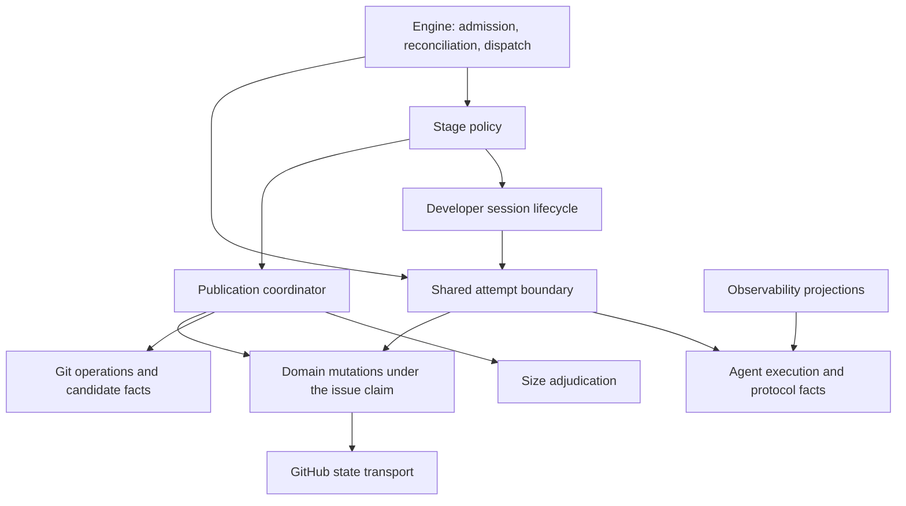

# Cohesion and coupling proposals

Checked against the implementation on `origin/main` at `daf452632` on 20 October 2026. The report is the starting
evidence; the [architecture](../docs/architecture.md), [state machine](../docs/state-machine.md), and
[agent contracts](../docs/workflow.md) define the existing behavior. This note abstracts the architectural findings
from the particular backend. It does not revalidate the report's operational measurements or live issue/PR status.

The main proposal is to organize shared behavior around the things whose invariants it protects: an agent attempt,
a developer session, a publication, and its evidence. A stage should own the meaning of those things for its phase
of the workflow. Currently, several shared responsibilities are housed in a stage, and stages repeatedly reconstruct
execution and recovery rules from loosely related fields.

## Evidence in the current tree

An AST scan of imports under `orchestrator/`, including imports inside functions, confirms **60 runtime modules outside
`implementing` import that package**, which contains **92 Python modules, including its initializer**. These counts
describe ownership spread, not a quality score or proof of an initialization cycle. The most reused owners include
`late_gate_models` (17 external importers), `late_records` (16), `session_read` (12), and `late_publication_state` (11).
Publication ownership therefore deserves as much attention as developer execution.

- **Execution facts:** [AgentResult](../orchestrator/agents/models.py),
  [result assembly](../orchestrator/agents/runner.py), and
  [session classifiers](../orchestrator/workflow/stages/implementing/session_read.py) divide process facts, provider
  diagnostics, session interpretation, and workflow decisions among owners; consumers must reconstruct their
  relationships.
- **Developer lifecycle:** [execution](../orchestrator/workflow/stages/implementing/execution.py),
  [session](../orchestrator/workflow/stages/implementing/session.py), and
  [resume](../orchestrator/workflow/stages/implementing/resume.py) house shared launch, rotation, recovery, and session
  persistence in one workflow-label package while serving several stages.
- **Publication policy:** [late gate](../orchestrator/workflow/stages/implementing/late_gate.py), the `late_*` owners
  beside it, and [workflow/late_split](../orchestrator/workflow/late_split/) divide one cross-stage
  publication/adjudication responsibility between a shared domain and implementation-stage internals.
- **Git versus workflow:** [transfer permits](../orchestrator/git/base_sync/transfer_permits.py),
  [terminal handoff](../orchestrator/git/base_sync/terminal_handoff.py), and
  [publication rewrite](../orchestrator/git/publication/rewrite.py) reach upward for authorization and durable workflow
  effects. Deferring imports avoids initialization problems but retains semantic coupling.
- **Durable state:** [tracked invocation](../orchestrator/workflow/engine/usage.py),
  [guarded commit](../orchestrator/workflow/engine/pinned_commit.py), and stage-level `write_pinned_state` calls provide
  a common launch-charging boundary, while completion capture and mutation discipline differ by path. Guarded quota
  retirement and docs launch records already protect specific completion obligations.
- **Recovered work:** [implementing recovery](../orchestrator/workflow/stages/implementing/spawn.py) and
  [documenting recovery](../orchestrator/workflow/stages/documenting/run.py) represent existing commits with synthesized
  `AgentResult` values, mixing candidate provenance with execution status. Documenting's unfinished-pass guard runs
  before its recovered-commit shortcut.
- **Protocol ownership:** `agents.models` imports `ToolLifecycle` from `observability.usage.agy_events`; backend
  execution also consumes that parser. Correctness depends on an owner whose package responsibility is observing runs.

## Proposed responsibility boundaries

The names below illustrate ownership boundaries. Existing cohesive owners should be retained where they already
serve the responsibility; this is not a request to create every package before changing behavior.

- **`agents/` and `agents/protocol/`:** CLI invocation, provider decoding, process/protocol facts, and authoritative
  session identity. Return an execution result with preserved evidence and explicit uncertainty.
- **`workflow/execution/`:** Admission, lifetime charging, attempt identity, durable completion capture, and
  launch/completion reconciliation. Return an attempt result or an explicit deferred decision.
- **`workflow/developer/`:** Developer session planning, pinning, rotation, retirement, and bounded recovery. Return a
  session plan and developer-operation result.
- **`workflow/publication/`:** Authorize a named candidate, coordinate push/PR publication, and settle receipts.
  Return a published, held, or refused candidate with its exact identity.
- **Existing `workflow/late_split/`:** Size-adjudication generations, entitlements, lineage, and their recovery.
  Return a decision about the named contribution and its publication rights.
- **Workflow report, verification, and rewrite owners:** Each domain's records, proofs, publication, reconciliation, and
  settlement. Return explicit evidence and outstanding obligations.
- **Existing guarded pinned-state owner:** Fresh reads, declared field changes, merge rules, and edit outcomes. Return
  confirmed, refused, or unconfirmed writes.
- **Stage packages:** Stage inputs, prompts, completion requirements, and routing.
  Return decisions specific to that stage.
- **`git/`, `github/`, and observability:** Git operations and facts, remote transport, and observation projections
  respectively. Return operation results without selecting stage policy.

Dependencies should point from workflow policy to operations and facts. Dispatch is a deliberate composition
boundary: the engine selects a stage, and stages call shared workflow services.

The existing lower-layer imports of the narrow workflow vocabulary remain permitted. The target removes lower-layer
imports of stage decisions and coordination. Direct imports from defining owners remain the rule; another facade,
service locator, or registry would add indirection without improving ownership.

## 1. Give execution facts one owner and keep stage decisions separate

Evolve `AgentResult` into a consistent, read-only result once decoding is complete. Keep process termination,
protocol completion, unfinished tools, failure categories, requested/returned session identities, and final reply
as distinct facts. Preserve the original process return when known and the normalized status separately. Unknown
protocol completion or identity must remain unknown rather than becoming success through missing fields.

Provider adapters should decode provider messages and session-health evidence. Move provider marker matching out of
`implementing/state.py` and `session_read.py`; keep session pin selection in the workflow. Define shared protocol
envelopes and tool lifecycle facts under `agents/`, and let usage and trajectory owners project those facts. Their
rendering and aggregation may differ, but identity, ordering, and terminal interpretation need one explicit contract.
Keep pricing and presentation in observability. Avoid parsing correctness evidence through a telemetry recorder.

A single failure enum should not erase simultaneous facts such as quota exhaustion, timeout, and unfinished tools.
Shared policy should answer operation-specific questions: whether an attempt completed, whether a conversation may
be resumed, and whether bounded automatic recovery is eligible. A stage separately decides whether preserved commits
can be published and whether its task is complete. A new commit proves neither completion nor verification.

**Benefit:** provider changes stay within execution decoding and shared lifecycle rules; stage code consumes stable
facts rather than adding another branch to every classifier chain.

**Check:** run the same composite outcome through recovery and stage policies. An unusable session is never resumed;
implementation salvage remains distinguishable from documentation completion and review approval.

## 2. Extract the shared developer lifecycle from `implementing`

Move shared responsibilities from `execution.py`, `session.py`, `session_read.py`, `session_retirement.py`,
`quota_retirement.py`, `quota_record.py`, and the shared parts of `resume.py`, `resume_request.py`, `models.py`, and
`state.py` to a neutral developer owner. Classify
helpers by responsibility before moving them: stage prompts, initial implementation setup, and implementation routing
stay with `implementing`; provider classifiers belong with agents; common comment formatting belongs with messages.

Preserve the existing quota-retirement boundary: every developer attempt retires an Antigravity quota-stopped
conversation before its pause check, and unresolved retirement holds later launches. The host record is armed before
an Antigravity launch; an unconfirmed retirement withholds the tick's state from whole-snapshot writes. These are
implemented lifecycle guarantees to retain through extraction, including their refusal to re-pin a retired conversation.

Replace the coordinator's `dict[str, object]` options and positional resume payload with typed requests containing the
locked command spec, role/stage attribution, worktree, delivered input, and recovery authorization. Keep the existing
launch fingerprint and budget contract. A request should state the policy it needs rather than pass enough mutable
context for the coordinator to infer the caller's intention.

The lifecycle should reconcile session state, plan an attempt, invoke the common tracked boundary, apply that attempt's
session effects, and only then decide whether another attempt is permitted. Initial, fresh-session retry, and bounded
command continuation are separate attempts. Returning only the last result must not discard earlier identity,
diagnostics, retirement obligations, or usage.

Use a result that names why work stopped instead of a tuple containing a boolean `paused`. Distinguish an actual pause,
shutdown, budget refusal, and unresolved persistence. Also distinguish `AttemptFinished` from `RecoveredCandidate`:
recovering existing commits should carry the candidate and its recorded provenance, without manufacturing a successful
agent run. Recovered publication spends no new run and must satisfy its own report/evidence obligations.

**Benefit:** fixing, documenting, conflicts, validation follow-ups, and other developer consumers share one lifecycle
without importing another stage's internals. New recovery rules have one execution owner.

**Check:** fresh and resumed developer paths preserve the exact command spec and worktree, charge every actual attempt,
respect the continuation bound, and retain session retirement across all callers. Reviewer rounds remain fresh;
question, discussion, and decomposer sessions retain their own role-specific policies.

## 3. Pair durable completion with the existing durable launch boundary

Extend the responsibility around `_run_agent_tracked`, rather than adding independent completion checkpoints to each
stage. It already provides a common place to refuse a launch and persist the lifetime charge before invoking the CLI.
That is also the place to establish an unresolved attempt obligation and capture a returned attempt before ordinary
stage effects can discard it. Reuse existing ledger identity and compatible records where their semantics suffice.

Capture bounded result facts, authoritative session identity, available per-invocation usage, and the reference to any
report/evidence obligation. Associate them with a stable attempt identifier and the launch's frozen inputs. Do not put
raw streams into the pinned comment: respect its size limit, and leave optional diagnostic retention in observation
sinks. Stage interpretation of a report belongs after capture, under the appropriate domain contract.

Separate completion/safety writes from ordinary effects. A live pause should stop publication, consumption-watermark
settlement, and routing while allowing narrowly owned accounting and session-safety obligations to be preserved. Every
automatic second attempt must wait for the first attempt's required effects to settle. Reconcile before planning, and
revalidate session identity and authorization immediately before launching.

Use GitHub for general attempt intent and completion, while preserving the documented host-local quota record as an
existing recovery obligation. Persist unresolved intent before external work, refuse launch if that write cannot be
confirmed, and hold later launches until the obligation is reconciled. A crash can still lose a returned reply; an
unresolved intent preserves uncertainty rather than claiming that reply is recoverable. Missing evidence may require
a human decision.

The current [quota record](../orchestrator/workflow/stages/implementing/quota_record.py) is flushed before a launch
depends on it, survives restarts on the same host, and is invisible to another host or a fresh `WORKTREES_DIR`.
An unresolved arming holds developer launches until its outcome is resolved; it is not reconstructible from GitHub
alone. Fold this obligation and the docs launch record into the common attempt contract without dropping either.
Replacing the host record would need an explicit migration preserving its pending retirements and backup/restore
contract. Logs and process dictionaries cannot substitute for durable attempt intent.

**Benefit:** pause, restart, and failed persistence become attempt-lifecycle concerns instead of repeated stage repairs.

**Check:** pause after either attempt, restart after return, and lose the completion-write response. The next tick
reconciles or holds, preserves each charge and available usage once, and cannot silently relaunch a retired session.

## 4. Put publication policy above git and outside a single stage

Give cross-stage publication coordination a neutral owner. Move the shared policy in `implementing/late_gate*`,
`late_push`, `late_publication*`, `late_transfer*`, `late_rewrite`, and related recovery owners according to what they
protect. Size-adjudication records and entitlements belong with the existing `late_split` domain; the coordinator that
authorizes and settles an exact publication belongs with publication. Avoid moving every `late_*` file as one bundle:
some implement stage-specific routing, while others define contribution identity or transport effects.

Continue the direction established by `engine/base_refresh.py` and the workflow rewrite coordinators. Git should
prepare and observe candidates, measure contributions, perform rebases/squashes, push named commits under the existing
lease protections, and report operation results. Workflow should read adjudication permissions, decide holds and parks,
record report/evidence debt, publish notices, and select labels. Move these decisions out of git's persistence,
transfer, and publication-rewrite paths instead of relocating their upward imports to another shared package.

Pass candidate identity and expected remote identity across the boundary. A workflow permit must remain bound to the
exact contribution and commit it authorized, and workflow must revalidate it at the actual publication boundary.
Lower-level git operations retain their checkout, commit, and lease checks. A successful git operation reports what
landed; it cannot independently declare workflow settlement complete.

**Benefit:** a new publication rule has one owner across implementation, fixes, docs, conflict resolution, and automatic
rewrites. Git can be understood and tested without loading stage authorization records.

**Check:** change the candidate or remote head between approval and push, interrupt a rewrite, and lose a push response.
Publish only the authorized object or defer; use remote evidence and receipts to reconcile what landed without a
second adjudication, destructive reset, or duplicate publication.

## 5. Keep domain mutations within the issue writer claim

Make field ownership and write outcomes explicit for session state, completion accounting, and shared parks. Retain
guarded pinned commits where their prerequisites and failure handling are needed. A whole-snapshot write inside the
issue's writer claim does not itself require another reread or reconciliation layer. Each domain declares the fields
it owns, prerequisites it decided on, and how additive values merge. Unrelated and unknown fields must survive writes.

Dispatch and base refresh take the issue's claim before reading it and hold it through their last write. Within that
operation, earlier writes are sequential checkpoints: another orchestrator writer cannot change the issue's pinned
comment or labels meanwhile. Do not add machinery to adopt or repair such a writer's intervening records. A successor
written between separately claimed operations remains real and is read after the next operation acquires the claim.

Put wire-field definitions and typed readers beside the domain that governs them. Session keys should not be imported
from `implementing` merely because that stage first wrote them. Validate internal records while preserving the existing
JSON keys, missing-versus-null distinctions, comment markers, watermarks, and event payloads. A move is not a schema
migration. Retain supported legacy reads until an explicitly authorized compatibility cutover.

Shared fields need an explicit rule rather than competing ownership claims. For example, usage totals are merged by
the accounting owner, input watermarks by the delivery contract, and `awaiting_human`/`park_reason` updates must depend
on the park being answered. A session repair must not clear an unrelated publication hold. Return confirmed, refused,
and unconfirmed write outcomes; a refused write and a possibly accepted write require different recovery.

Preserve handling for crashes between writes, refused or unconfirmed edits, comment capacity, and changes outside the
orchestrator: humans, labels, issue text, PRs, remote branches, configuration, and checkouts. Comment PATCH replaces a
whole body, and guarded rereads are not server-side compare-and-swap. Keep the supported host-local claim scope;
better mutation ownership does not create an atomic transaction across labels, comments, pushes, or multiple hosts.

**Benefit:** stages use explicit domain changes and recovery outcomes within the existing single-writer contract.

**Check:** apply session, usage, evidence, and watermark updates as sequential checkpoints; interrupt between writes,
refuse an edit, or lose its response. On the next claimed operation, read the state left by earlier operations.
Preserve unrelated fields and hold downstream effects until the domain can prove settlement.

## 6. Give report, verification, and rewrite families cohesive homes

The `engine/report_*`, `verification_*`, and `rewrite_*` families already represent distinct domain lifecycles. Group
their records, proofs, publication, and reconciliation under focused workflow owners, leaving tick admission,
scheduling, and dispatch in `engine`. This improves cohesion only when callers use a domain operation instead of
reaching through several implementation helpers. Moving filenames alone does not achieve that.

Production recovery handles captured evidence and
[writes recovery parks whole](../orchestrator/git/base_sync/persistence.py) under its caller's issue writer claim.
[The finish coordinator](../orchestrator/workflow/engine/rewrite_finish.py) also exposes a dormant settled-evidence
policy to direct callers selecting `LandedFinish.proves_settled`; production routes do not select it. Moving these
owners must preserve which policy is active; activation is a separate behavioral change.

Keep developer reports and verification evidence distinct: a report describes work; verification establishes command
results under a particular context. Relate them through existing attempt, contribution, head/tree, requirements, and
review identities. A rewrite coordinator must state which evidence carries, which becomes invalid, and which remains
owed before it selects the next stage. Reuse the current exact-evidence and receipt contracts rather than inventing a
second definition of a valid head.

Rewrite publication already reconciles notices against the PR and events against the audit log and its rotated
copies. With no audit log, a durable announcement record counts as filed unless the current process's shared
[owed-event ledger](../orchestrator/workflow/engine/owed_events.py) still owes it. Preserve those distinct recovery
rules when moving publication and observation owners; the process ledger does not provide durable attempt capture.

Recovery belongs with the obligation being recovered. The engine asks those domains to reconcile in an explicit,
documented order; each returns settled, held, or deferred with a reason. Preserve existing cancellation, pause,
adjudication, report, and verification precedence. Extract shared verification operations or notice rendering from
stage owners when engine code needs them, while keeping the stage's approval decision local.

**Benefit:** adding a producer of reports or verification does not require it to understand every record reader,
publication helper, and recovery branch in the engine.

**Check:** publish code, interrupt report delivery, rewrite the head, and resume. A reviewer or merge-ready route sees
evidence for the current context; pending obligations settle through receipts without duplicate posts or stale approval.

## 7. Keep stage policies small, explicit, and different where required

A stage handler should coordinate its inputs, choose its prompt and role policy, consume an attempt or recovered
candidate, decide its own completion condition, and request guarded effects from shared owners. Factor a pure decision
function where branch ordering is difficult to review. Do not introduce a common stage superclass or a universal
success handler: the stages have different obligations.

- **Implementing:** Keep initial implementation inputs, salvage disposition, and initial PR handoff local. Consume the
  developer lifecycle, report recording, and candidate publication.
- **Fixing:** Keep feedback batches, debounce, fix-round spending, ACK versus committed fix, and the return route local.
  Consume the developer lifecycle, delivered-input settlement, and publication.
- **Documenting:** Keep the full docs prompt, checked-head identity, explicit no-change/completed-update verdict, and
  final-docs route local. Consume the developer lifecycle, candidate provenance, publication, and evidence.
- **Validating:** Keep review rounds, verdict interpretation, approval conditions, and change-request handoff local.
  Consume fresh reviewer attempts, developer follow-ups, and verification and rewrite services.
- **Conflicts:** Keep the conflict-resolution task and completion checks for the intended branch/base local. Consume the
  developer lifecycle, git conflict facts, and guarded publication.
- **Decomposing, blocked, umbrella:** Keep scope decisions, manifest/dependency semantics, and family coordination
  local. Consume common attempts, domain persistence, and existing adjudication contracts.
- **In review:** Keep human feedback scanning, watermarks, merge/close handling, and readiness conditions local. Consume
  current publication/report/verification facts.
- **Question and discussion:** Keep their conversation contract, role session policy, and allowed effects local. Consume
  common attempt capture and delivered-input facts.

Move incidental shared readers out of sibling stages when several stages need them. Keep intentional stage dispatch
in the engine and represent handoffs with explicit prerequisites and receipts. Pass minimal typed values at service
boundaries instead of requiring each helper to know the entire stage context and mutable pinned record.

For example, documenting can accept `CompletedUpdate(candidate)` or `CompletedNoChange(checked_head)` only after its
execution and documentation contracts hold. A failed attempt that left a commit remains a failure with preserved work;
its commit alone cannot mint a docs verdict. Implementing can separately permit salvage through its existing safety,
report, and publication checks. Recovery must establish the earlier candidate's provenance before either decision.

The existing [failed-pass owner](../orchestrator/workflow/stages/documenting/failed_pass.py) already enforces that
distinction for Antigravity: a failed pass parks even with a commit or a no-change reply. Its guarded
`docs_launched_sha` record blocks recovered-commit publication and base refresh until the pass is accounted for.
A trusted continuation reruns the full docs prompt under the pinned command, using a fresh conversation where the
quota retired the earlier one; successful completion may then publish the preserved commit. Preserve this behavior
when introducing explicit results.

**Benefit:** shared safety rules change centrally while documentation, implementation, review, and conversation
semantics remain visible in the stages that own them.

**Check:** a compact policy table per stage covers complete, failed, deferred, and recovered inputs, including committed
work beside a failed result. Assert the resulting labels, verdicts, reports, and next-tick behavior.

## 8. Measure improvement through boundaries and failure journeys

Extend the existing import checks to hold the intended ownership direction, including imports inside functions.
As responsibilities move, remove the corresponding exceptions in `tests/repository/test_layering.py`. Shared workflow
services should not import stage internals, and git should not import publication/adjudication coordination. Keep the
intentional engine dispatch and narrow workflow-vocabulary exceptions. Preserve clean-process import checks and one
defining owner per seam; move tests and patch targets with that owner.

Add focused behavioral checks at the boundaries that the report exposed:

- Adapter contracts with sanitized, version-identified streams: terminal completion, tool finality, session identity,
  and per-invocation usage on resumes. Preserve unknown or conflicting evidence explicitly.
- Attempt-chain checks: every actual launch is charged and captured, every required session effect settles before
  recovery, and a refused launch or recovered candidate cannot impersonate a completed run.
- Multi-tick journeys: a failed attempt with commits, pause after completion, restart before settlement, human
  continuation into a fresh session, and a moved candidate before publication.
- Persistence fault injection through existing doubles: refused edits, accepted edits with lost responses, comment
  capacity, malformed records, external changes, and state left by earlier claimed operations. Competing-poller
  checks should prove claim exclusion and handoff between operations, not interleave two writers inside one claim.
- Direct assertions for forbidden extra launches, duplicate pushes/posts, repeated charges or usage, and incorrect
  delivered-input consumption. Observe durable state and what the next tick does, not same-package helper calls.

Keep report/verification contracts and wire-format checks alongside these journeys. Isolate adapter probes and manual
smoke runs from operational observation sinks. Tests should establish invariants across owners, not mirror the helper
sequence. Reduced change propagation is the practical success measure: a provider failure rule should not edit every
stage, and a publication rule should not edit git's workflow callbacks. File count and module size are supporting data.

## Adoption order and constraints

1. Define execution facts and explicit stage policies in the current owners. Preserve the implemented quota-retirement
   and failed-docs safeguards, and address remaining completion/recovery gaps with focused behavioral checks before
   changing package ownership.
2. Extract developer lifecycle and strengthen the shared attempt boundary. Add explicit deferred/recovered results
   and durable completion handling while preserving lifetime charging and role-specific session behavior.
3. Extract shared publication/adjudication coordination and remove upward git policy calls. Preserve exact candidates,
   leases, authorization receipts, and recovery ordering throughout.
4. Clarify domain mutations within the issue writer claim and organize report/verification/rewrite ownership as
   callers are migrated. Tighten architecture checks as each responsibility acquires its final owner.

Separate moves that preserve behavior from changes to lifecycle semantics so regressions have an identifiable cause.
Use existing runners, GitHub doubles, locks, and commit machinery; no external dependency or new service is needed.
Update authoritative module inventories and owner patch targets with any future move. Preserve workflow labels,
pinned-state fields, markers, watermark namespaces, event shapes, pinned command specs, run-budget limits, and
pause/close protections. These proposals authorize no compatibility migration or expansion of the concurrency model.
