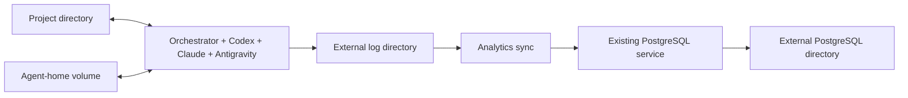

# Docker deployment and external runtime storage

Date: 2026-09-17; revised 2026-11-26. Status: implementation plan; all subtasks are pending.
Subtask 2 uses the current [Poetry tooling](../docs/configuration/operations.md#dependency-tooling), and subtask 4
sizes storage for its per-worktree environments.

This is working material, not a specification. Saving this plan does not migrate data or change running services.
Implementation must follow the repository's authoritative documentation and the
[development conventions](../.agents/skills/develop/SKILL.md).

## Confirmed requirements

- Run the orchestrator and Codex, Claude Code, and Antigravity (`agy`) together in a Docker container.
- Serve target repositories with other toolchains, not only this Python repository. The first real target is 6Money,
  a Swift package built and tested with `swift build` and `swift test`, under a different GitHub owner.
- Use account/subscription logins for all three agent CLIs and preserve login and conversation state across restarts.
- Keep the existing permission-bypass behavior. The security objective is protecting the rest of the host;
  credentials and files available inside the container are within the accepted trust boundary.
- Supply GitHub credentials at container startup in one of two forms: one `GITHUB_TOKEN`, for example through
  `docker run --env GITHUB_TOKEN` with the variable already exported, or per-repository token files supplied
  read-only from outside the project tree at the path the orchestrator already resolves,
  `~/.config/<owner>/<repo>/token` under the agent home. One fine-grained token covers one owner, so targets under
  different owners need the files. An exported `GITHUB_TOKEN` or `ORCHESTRATOR_TOKEN_FILE` answers for every
  repository ahead of those files, so a deployment that uses them sets neither. Do not bake credentials into an image.
- Mount one chosen project directory for development. A dedicated directory of fresh clones is the default. `~/git`
  stays supported, with the warning that it exposes the untracked and git-ignored files of every sibling checkout to
  agents. Everything accessible under that mount is available to agents, including sibling repositories and
  uncommitted changes.
- Reuse the PostgreSQL service already running in Docker on the same machine.
- **First move database and log-related runtime data out of `~/git/chipping-orchestrator/`.** Put it outside `~/git`
  altogether so mounting that project tree cannot expose the database or its backups. This storage migration gates
  mounting any tree that contains this checkout's runtime data, and the cutover of this repository. It does not gate
  a deployment whose project directory lacks this checkout.

## Target layout

The following names are proposed deployment defaults, not settings that already exist in the application.
Resolve host paths to absolute paths in deployment configuration; do not rely on application-side `~` expansion.
The Compose project, agent-home volume, and log directory names are deployment parameters, so two deployments can
coexist on one host, for example one per target whose `VERIFY_COMMANDS` differ. The names below are defaults.

```text
~/.local/state/chipping-orchestrator/
  postgres/       PostgreSQL data; mounted only by the database container
  logs/           Runtime logs, JSONL sinks, rotations, and maintenance-job output
  backups/        Database dumps, archived logs, and migration/rollback records

~/.config/chipping-orchestrator/
  deployment.env  Host paths and non-secret deployment settings
  analytics.env   Database settings for the database, sync, and existing dashboard as needed

<chosen-project-directory>/
  <repo>/         Target clone, including its Git common directory
  wt-orchestrator/ Persistent issue worktrees

Docker external named volume:
  chipping-orchestrator-agent-home  Dedicated /home/agent, including account and session state
```

A dedicated project directory of fresh clones is the default; `~/git` remains a supported choice after the storage
migration, with the exposure warning under [Confirmed requirements](#confirmed-requirements).
The Docker engine's own data root and the agent-home volume must also be outside the mounted project tree.

| Container | Mounts | Credentials and network access |
|---|---|---|
| Orchestrator and agents | Project tree RW, external logs RW, agent home RW, token files RO | GitHub, agent accounts |
| Analytics sync | External logs RO; optional separate location for its own output | Database credentials, DB network |
| Existing PostgreSQL | External PostgreSQL directory; schema source RO if retained | Existing database identity |

The token files are the per-repository ones from [Confirmed requirements](#confirmed-requirements), when used. Bind
each file read-only from outside the project tree to `/home/agent/.config/<owner>/<repo>/token`, one file per
repository, never its host directory.

Moving logs out of the project requires a **second, narrowly scoped host bind for logs**, in addition to the one
project-directory bind. This is an explicit adjustment to the earlier layout that put logs under `/workspace`.
Mount only the `logs/` leaf into the agent container, never the complete state directory, `postgres/`, `backups/`,
host home, host keyring, or deployment configuration directory. A log named volume is an alternative only if exactly
one host bind in total becomes a requirement; the plan below uses the explicit external log directory.

Keep the existing database Compose project independently managed. The new deployment joins its database network
only from the analytics sync service. The polling loop never requires PostgreSQL.



## Agent and operator work

- Agents write configuration, scripts, tests, and runbooks, and prove them on disposable fixtures: synthetic build
  contexts, temporary paths and homes, fake CLIs, disposable databases, and disposable repositories.
- Only the operator runs the live migration, provider logins, firewall rules, cutover, and production scheduling.
- Each subtask lists the operator steps it leaves. Those steps are not an agent's acceptance criteria: an
  implementation is complete when its agent proof passes, and the operator then follows the runbook it wrote.

## Subtasks and order

| ID | Deliverable | Depends on | Approximate scope, including tests and documentation |
|---|---|---|---|
| 1 | External runtime storage and verified migration | None; merged first | Medium, about 7-10 files |
| 2 | Reproducible image containing the orchestrator and all three CLIs | 1 | Medium, about 6-8 files |
| 3 | Persistent subscription authentication and session bootstrap | 2 | Medium, about 4-6 files |
| 4 | Hardened orchestrator deployment and controlled host cutover | 3 | Medium/large, about 10-14 files |
| 5 | Containerized analytics sync using the existing PostgreSQL network | 4 | Small/medium, about 3-5 files |

**The operational migration in subtask 1 is a release gate, not just a merged configuration change.** Later
subtasks may be implemented and merged before the operator performs the live migration. The gate blocks the
deployments named under [Confirmed requirements](#confirmed-requirements): mounting any tree that contains this
checkout's runtime data, and the cutover of this repository, until subtask 1's operator steps are complete. A
deployment whose project directory lacks this checkout, such as the Swift target's trial in subtask 4, does not wait
for it. Host-side operation resumes on the external storage once the migration completes.

These are planning estimates, not issue-size exemptions. Reassess completion scope when creating implementation
issues. Each subtask includes its own tests, consequent documentation, and final documentation pass as required by
the [decompose skill](../.agents/skills/decompose/SKILL.md). There is no separate checks-only or documentation-cleanup
subtask. Together they cover the parent; no residual parent implementation is planned.

## 1. Move database and log data outside the checkout

**Unique deliverable:** the existing host deployment continues working with all database persistence and log-related
data outside the project tree, with a verified rollback path. This is independently useful before containerizing
the orchestrator.

### Changes

- Parameterize the database data bind with an explicit absolute deployment path, such as `POSTGRES_DATA_DIR`.
  Preserve long-form mounts and `create_host_path: false`; a missing or incorrect source must fail rather than
  create a new empty database. A path outside the entire project mount is required for this deployment.
- Keep database name, roles, permissions, schema, extensions, and the current PostgreSQL major version intact.
  Determine the running version during migration; `analytics-db/compose.yml` currently specifies `postgres:16`.
  A PostgreSQL upgrade is outside this subtask.
- Set the existing host launcher's `LOG_DIR` to the external log directory. Relocate explicit
  `ANALYTICS_LOG_PATH`, `EVENT_LOG_PATH`, and `TRAJECTORY_LOG_PATH` overrides when configured. Preserve disabled sinks
  and retention settings; relocation must not turn optional recording on.
- Include rotated `orchestrator.log` files, analytics/audit/trajectory JSONL files, archives, sync cron output,
  trajectory mirror/prune output, and any existing dashboard or maintenance output written beneath the checkout.
  Inventory configured writers and readers without printing file contents or secrets.
- Update the existing systemd/cron/manual launch configuration, dashboard inputs, mirror jobs, retention jobs, and
  backup paths together. Keep deployment credentials outside the project tree using explicit environment files.
- Prefer deployment overrides for the already-supported log paths. Changing global application defaults is not
  required to migrate this installation; preserve compatibility for other host deployments.
- Keep tracked Compose files and schema SQL in the repository. Runtime data and credentials move out.

### Migration procedure to implement and document

1. Record the running database version, container/project identity, network, bind configuration, and all configured
   log consumers. Query the database through PostgreSQL clients; do not inspect its raw files.
2. Schedule downtime, stop the host poller and all log/database writers, and drain agent subprocesses. Suspend sync,
   prune, mirror, and rotation jobs during the copy so files and database comparison counts remain stable.
3. Take a logical database backup into the external backup directory, including required roles/grants. Verify the
   backup command succeeds and retain it through cutover. Use `pg_dump` with globals or an appropriate `pg_dumpall`
   workflow; account for any additional databases and tablespaces before choosing the restore procedure.
4. Restore into a separate destination using the external PostgreSQL path and the same major version. Keep the
   source intact. Fail on restore errors, handle bootstrap-role conflicts explicitly, and avoid replaying schema
   initialization over a restoration in a way that hides failures.
5. Compare schema objects, roles/grants, table counts, and representative analytics/content hashes. Refresh and
   check the materialized rollup and existing dashboard queries. Run a controlled sync replay to confirm deduplication.
6. Copy the stopped log streams and their rotations to the external log directory; compare sizes/checksums and
   preserve suitable ownership and permissions. Archive migration evidence outside the workspace.
7. Recreate the database container with the new bind configuration and switch consumers to the migrated service.
   A container restart alone does not change its saved bind source. Verify mount metadata and SQL health before
   resuming the host poller and scheduled jobs.
8. Verify fresh records go to the external locations. The operator relocates any retired raw database directory and
   remaining log copies outside the future project mount after validation. Retain rollback material outside that
   mount until the agreed retention period ends; do not replace paths with symlinks into the external state tree.

The repository explicitly makes `analytics-db/data/` off limits to agents. Raw-volume preparation, physical handling
of the retired directory, and any ownership work belong to the operator. Do not provide an agent-run recursive
copy, scan, `chown`, deletion, or elevated retry against that directory. Use the database protocol for logical
backup/verification and synthetic directories for automated tests. This plan does not authorize an agent to perform
the live migration.

**Rollback:** keep the source service and logical backup recoverable until destination validation passes. Before
new writes, restore the previous endpoint/configuration if necessary. After new writes, first quiesce writers and
preserve/reconcile destination changes; blindly switching to the stale source would lose data. A rollback that
temporarily restores checkout-local storage also closes the gate again, as
[Confirmed requirements](#confirmed-requirements) defines it: until the storage is external again, no deployment
mounts a tree that contains this checkout's runtime data, and this repository does not cut over.

**Likely owners/files:** `analytics-db/compose.yml`, `analytics-db/.env.example`,
`orchestrator/service/.env.example.advanced`, `tests/repository/test_analytics_compose.py`,
`docs/observability/analytics-database.md`, `docs/configuration/observability.md`,
`docs/configuration/operations.md`, and applicable examples in `docs/observability/trajectories.md` and
`docs/security.md`. Update operator service files outside the repository during the migration. Amend `AGENTS.md`
only if its operator-data safety routing must cover the new storage location; keep the prohibition on the legacy
path while it can still exist.

**Acceptance and verification.** Agent proof, on disposable fixtures:

- Missing external bind sources fail safely, and database access remains restricted to its intended clients.
- Update the Compose-rendering test to assert the external source and no automatic source creation. Run it against
  a copied Compose file and temporary paths, never the operator directory.
- Verify explicit log paths and inherited analytics paths using existing configuration/logging tests if changed.
  Include a restore rehearsal on disposable data; a successful config render alone does not establish data
  preservation.

Operator steps this subtask leaves, which open the gate:

- Perform the live migration with the procedure above, and update the operator service files outside the repository.
- The existing deployment works against the relocated database and logs; validated backup and rollback records exist.
- Neither active nor retired database/log data remains under the chosen project mount before the gate opens.
  Operator confirmation covers the protected raw data directory; agents do not traverse it to prove absence.

## 2. Build the image with the orchestrator and all three CLIs

**Unique deliverable:** a versioned Linux image that can run the orchestrator, `codex`, `claude`, and `agy`, and an
extension point that adds the development tools needed by each target project. It remains a usable image
independently of the production Compose service and login bootstrap supplied by later subtasks.

### Changes

- Add a Dockerfile with a supported Python 3.12+ base, Git, CA certificates, shell, and `rg`. Target build/test
  tools come through the extension point below. Justify any additional OS package needed by a CLI.
- **Install the orchestrator from a wheel, not from the source tree.** Use a builder stage with Poetry 2.5.1 and
  `poetry-plugin-export==1.10.1`, matching the current CI pins. It runs
  `env -u VIRTUAL_ENV -u CONDA_PREFIX poetry build --format wheel` and
  `env -u VIRTUAL_ENV -u CONDA_PREFIX poetry export --only main -f requirements.txt`; keep the hashes in the export.
  The runtime stage copies the export first and installs it into a dedicated virtual environment with
  `--require-hashes`. It then copies the wheel and installs it with `--no-deps`.
  Neither Poetry nor `poetry.lock` reaches the runtime stage, and the optional
  `dashboard` and `docs` groups stay out because the export covers only the main group.
- **Keep the dependency layer stable across releases.** Like uv, Poetry cannot install from its lock without
  `pyproject.toml`, and that file changes with every version bump. The export leaves out the root project, so a
  release that changes no dependency reuses the cached dependency layer and rebuilds only the wheel layer.
- **Wheel source.** PyPI releases now exist. Building the wheel from the checkout stays the default, so the image can
  carry an unreleased commit. Installing a published release with its constraints asset, as the
  [maintainer guide](../CONTRIBUTING.md#publishing-to-pypi) and the
  [pinned procedure](../docs/configuration/operations.md#pin-a-release-and-runtime-dependencies) define them, is the
  documented alternative.
- **Target toolchains are an extension point.** An operator adds a target's build and test tools without editing the
  tracked Dockerfile, for example through a derived image built `FROM` the agent stage. Tools stay outside the agent
  home, and each extension checks its toolchain's supported distribution and architecture against the base image.
  Document two instances. Poetry for this repository: when it is itself a target, agents run
  `env -u VIRTUAL_ENV -u CONDA_PREFIX poetry sync` and `env -u VIRTUAL_ENV -u CONDA_PREFIX poetry run` in its
  worktrees, so its extension pins Poetry 2.5.1, separate from the orchestrator's runtime environment. A Swift
  toolchain with `libsqlite3-dev` and `pkg-config`, for the first real target, is the other.
- Pin compatible CLI releases and record image provenance. Antigravity has a native Linux CLI; a desktop IDE is
  not required for its current headless backend. Verify supported architecture and runtime libraries for each binary.
- Separate the common Python runtime build stage from the agent tooling so the sync service can reuse a smaller
  target without account credentials. Keep optional dashboard dependencies out unless an existing consumer needs them.
- Use an allowlisted build context with the image's own ignore file; exclude `.git`, `.env` files, local
  virtualenvs, logs, database data, backups, and authentication/session state. Do not use a broad context copy that
  can include them. A root `.dockerignore` already exists as the allowlist for `.clusterfuzzlite/Dockerfile`, guarded
  by `tests/repository/test_fuzz_build.py`. The new image does not widen it: a Dockerfile-specific ignore file
  beside the new Dockerfile (`Dockerfile.dockerignore` for a root `Dockerfile`), which BuildKit reads in place of
  the root `.dockerignore`, carries its own allowlist.
- Install executable tools outside the persistent agent home so mounting an empty home does not hide binaries.
  Provide a non-root account and an explicit UID/GID strategy for the host's writable project and log directories.
- Start the installed orchestrator directly. Image upgrades rebuild/recreate the container; `run.sh`'s checkout
  pull/restart behavior is not the container update mechanism. Keep the image's runtime source free of `.git` so the
  self-update probe cannot create an exit/restart loop against an immutable checkout.

**Likely owners/files:** new `Dockerfile` and its own `Dockerfile.dockerignore`, focused tests under
`tests/repository/`, `README.md`, and `docs/configuration/operations.md`; the root `.dockerignore` and
`tests/repository/test_fuzz_build.py` stay unchanged. Reuse `tests/runtime/test_self_update.py` if runtime behavior
needs adjustment. Avoid an application change when packaging without Git metadata already satisfies the requirement.

**Acceptance and verification.** Agent proof: build without secrets, run all CLI help/version commands and
orchestrator help, verify the effective user and base tools, and inspect an image built from a synthetic context for
excluded sentinel files; the fuzz build's context test still passes. Compare the runtime environment's installed
versions with the exported pins. Show that rebuilding after a version-only change reuses the dependency layer.
Verify the installed orchestrator does not depend on a writable source checkout or start its source-update loop. A
derived image built from a synthetic context puts its added tool on the agent user's `PATH` with an empty agent home
mounted. These checks do not claim authenticated agent execution; that belongs to subtask 3.

Operator steps this subtask leaves: build the deployment image and the derived images for the actual targets, such
as the Swift toolchain, on the deployment host, and record their provenance.

## 3. Bootstrap and preserve subscription logins

**Unique deliverable:** an interactive setup entrypoint and persistent state arrangement that make all three account
logins usable for unattended agent runs after container replacement.

### Changes

- Provision a dedicated, explicitly named external Docker volume for `/home/agent`, with suitable ownership.
  Preserve credentials, conversation histories, project indexes, and caches. Keep the volume through rebuilds and
  routine Compose teardown; document backup and reauthentication without exposing credential contents.
- Provide a setup mode that starts the required local services and opens an interactive shell as the same user,
  with the same home and project paths as the eventual daemon. Setup must not launch the polling loop.
- Codex: use account login, preferably device authentication, and file-backed credential storage under its home.
  Keep the cache writable so refreshed credentials persist.
- Claude Code: use its subscription login and browser URL/code flow. Preserve the complete dedicated home, including
  configuration outside `~/.claude`, rather than copying only one credential file.
- Antigravity: provide a container-local D-Bus session and unlocked credential store as required by the installed
  CLI. Define and test keyring creation, persistence, unlocking after restart, and a login flow usable from the
  operator's host browser. Do not mount the host session bus, keyring, or browser profile.
- Make bootstrap failures actionable. Preserve state and request reauthentication when required; do not silently
  fall back to API billing. The earlier `GEMINI_API_KEY` filtering observation needs no change for this account-only
  design.
- Decide how CLI self-updaters are disabled or constrained so the tested releases remain consistent with the image.
  Verify the chosen mechanism against each installed release rather than assuming a shared setting.

**Likely owners/files:** new bootstrap/entrypoint scripts under a deployment directory such as `docker/`, Dockerfile
additions for the credential store, focused bootstrap tests under `tests/repository/`, and the authentication section
of `docs/configuration/operations.md`. Consult `orchestrator/agents/backends/`, `agents/environment.py`, and
`docs/workflow/command-specs.md`; change those only if a demonstrated container integration requires it.

**Acceptance and verification.** Agent proof: automated tests prove the bootstrap with fake CLIs and temporary homes.
They show that setup runs as the daemon's user with its home and project paths and does not launch the polling loop,
that state written in the home survives recreating the container with the same volume, that the container-local
keyring is created, persists, and unlocks after recreation, and that missing logins produce actionable failures
without an API-billing fallback. Subscription credentials never enter the repository or CI. The runbook documents
credential refresh/reauthentication behavior.

Operator steps this subtask leaves, from that runbook: authenticate all three accounts, run a minimal headless request
with each backend, recreate the container using the same volume, and verify another request and conversation
resumption. Specifically exercise Antigravity's keyring startup after recreation with the real account. These
manual provider checks belong to this subtask, not a later checks-only task.

## 4. Deploy the hardened orchestrator and switch from the host process

**Unique deliverable:** a Compose service and operator workflow that run the authenticated image with constrained
host access, correct worktree paths, predictable shutdown, and controlled image upgrades.

### Changes

- Add the orchestrator Compose service with explicit project/log binds, the external agent-home volume, a non-root
  user, `init: true`, a restart policy, and a shutdown grace period appropriate for agent process-group teardown.
- Set a read-only root filesystem, `cap_drop: [ALL]`, `no-new-privileges`, and the default seccomp profile. Provide
  only the writable tmpfs/runtime paths actually needed by Python, build tools, D-Bus, and the credential store.
- **Executable temporary path for the service.** Whatever the target language, the service needs a writable,
  executable temporary path: authenticated Git fetches and pushes execute a `GIT_ASKPASS` script the orchestrator
  writes into Python's temporary directory (`TMPDIR`, else `/tmp`). Docker mounts tmpfs `noexec` by default, so mount
  that path `exec` or point `TMPDIR` at writable storage that allows execution.
- **Compiled-language targets.** Writable cache paths and tmpfs options (size, `exec`) come from deployment
  configuration. Docker mounts tmpfs `noexec` by default, which breaks build tools that run a freshly compiled
  helper from the temporary directory; a target that needs one gets an `exec` mount for that path.
- Set configurable CPU, memory, PID, tmpfs, and Docker-log rotation limits. Set a workspace/cache disk quota or use
  bounded storage where needed; memory/PID limits do not bound writes to a host bind or named volume. Quotas are
  configurable per target. Size them from each target's per-worktree build directories, times the worktrees the
  deployment keeps, plus its tool caches. For example, Poetry copies packages into each worktree's `.venv` instead
  of hardlinking them from its cache, about 89 MB per worktree for the default groups, and its package cache lives
  in the agent home volume.
- Keep host PID/IPC/network namespaces, Docker sockets, host devices, SSH agents, and host home out of the service.
  Projects whose tests require Docker need a separate future design; do not weaken the production profile for them.
- Use an isolated bridge and an operator-owned outbound policy that blocks unintended access to host and LAN
  services while allowing provider authentication/inference, GitHub, DNS, and each target's package sources. Package
  sources are configurable per target, not fixed to one registry: PyPI serves this repository, while a Swift
  package fetches its dependencies from the Git hosts its manifest names. Cover IPv4/IPv6 and traffic addressed to
  the host itself as well as forwarded traffic. Keep firewall administration outside the agent container and
  document rule installation, verification, and rollback for the actual host.
- Pass `GITHUB_TOKEN` from the launch environment by name, or bind the per-repository token files read-only as the
  [target layout](#target-layout) describes. A repository without a resolvable token fails startup by name, before
  the polling loop starts. Inject only needed settings; do not pass the database environment file wholesale to this
  service. Existing child-environment filtering stays.
- Pass `VERIFY_COMMANDS` and `VERIFY_TIMEOUT` through per container from deployment configuration, since they are
  one list per poller. A container's list suits every repository in its `REPOS`; the Swift target's container
  runs `swift build` and `swift test`.
- Configure every target through `REPOS`, with an absolute container path in each entry. `REPO` and
  `TARGET_REPO_ROOT` are developer settings that an installed package does not read; without `REPOS` it exits
  before polling. Use absolute container paths for `WORKTREES_DIR`, `LOG_DIR`, and enabled JSONL sinks too.
  Suggested log paths are `/var/log/orchestrator/` and worktrees beneath `/workspace/`.
- Keep the clone's Git common directory and every managed worktree visible. Worktree metadata can contain absolute
  paths: use stable identical host/container paths for an existing layout, or perform a deliberate migration and
  repair before using `/workspace`. Do not assume a relocated worktree remains usable on both host and container.
- Recreate the image for upgrades and retain the previous image for rollback. Keep the host `run.sh` workflow for
  non-container deployments. The baseline uses the existing Docker daemon; rootless Docker remains an optional
  follow-up because a separate daemon changes UID mappings and connectivity to the existing database network.

### Cutover

Before a container polls a repository, stop and disable every other poller that lists it, the host polling service
included. Avoid concurrent orchestrators on the same repository even if their worktree locks happen to differ: a
repository is listed in exactly one poller. The writer claims of
[C-05](../docs/contracts.md#c-05-writer-claims-and-artifact-maintenance) exclude only pollers that share one
`WORKTREES_DIR`, so the `REPOS` lists carry that exclusion. Preserve GitHub pinned state, clone/worktree contents,
and required CLI conversation histories. Fresh account logins alone do not import histories from the host.

This repository's cutover also carries its host records and its GitHub identity. Every change of the repository's
`WORKTREES_DIR`, the forward cutover and any rollback alike, carries its current records in
`WORKTREES_DIR/.issue-writer-claims/`, the files named for its numeric repository id, from the root it last ran
under to the receiving root, so the receiving root holds exactly the repository's current records and none older.
Stop every poller using either root for the repository first, and start the receiving poller only after the copy.
Those records include the Antigravity quota retirement record, the only place an owed retirement lives until the
pinned comment takes it ([backup and restore](../docs/security.md#backup-and-restore-drills)): a fresh root can lose
one, and a rollback to the earlier root can read a stale record and resume a conversation whose retirement is still
owed. The container's token must authenticate as the GitHub account that authored this repository's pinned
comments: pinned state trusts only that account's comments
([pinned-state authentication](../docs/security.md#pinned-state-authentication)), so a token for another account
fails to authenticate every existing record.

Prefer switching after active conversations have finished. If unfinished issues must carry over, migrate only the
required backend state and verify their pinned session IDs and paths before cutover; otherwise continue on the host
until they can finish. Do not clear pinned session fields or discard dirty worktrees to force startup.

Trial in this order. First, a container against a disposable repository. Second, a container with only the Swift
target in `REPOS` while the host poller keeps this repository; its project directory lacks this checkout, so the
subtask 1 gate does not hold it. Third, the cutover of this repository once that gate is open. Restarting and
rolling back the image must preserve worktrees, external logs, credentials, and session discovery. Rolling a
repository back stops the container polling it before any host poller lists it again, and carries its host records
back as above when the worktree root changes.

**Likely owners/files:** new root/deployment Compose file, deployment environment example, bootstrap/preflight
scripts, an outbound-policy example with reachability probes, a small compiled fixture project, focused
Compose/lifecycle tests under `tests/repository/`, `docs/configuration/operations.md`, `docs/security.md`, and
`README.md`. Extend `tests/runtime/` or `tests/agents/` only for actual behavior changes.

**Acceptance and verification.** Agent proof, on disposable fixtures: render Compose with synthetic values; inspect
mounts, UID, capabilities, namespaces, and limits, and that configured quotas, tmpfs options, cache paths, package
sources, `VERIFY_COMMANDS`, and `VERIFY_TIMEOUT` reach the service; verify permitted writes and failure to access
harmless sentinel files outside the mounts. Exercise shutdown with an agent and descendant process, restart/session
recovery, missing-path/credential diagnostics, including a repository without a resolvable token failing startup by
name, and worktree create/commit/test operations against a disposable repository. Prove successful startup in both
credential modes on a disposable startup fixture with fake tokens: as the service user, two repositories under
different owners each resolve their own token file mounted read-only, distinct from the other's, and a single
launch-environment `GITHUB_TOKEN` starts the same fixture. Inside the hardened container, have the orchestrator's
Git askpass helper answer a local `git credential fill` with a synthetic token and no network request, and show the
same lookup fails when the temporary path is `noexec`. Build and test the small compiled fixture project inside
the hardened container, and show that the same build fails under Docker's default `noexec` tmpfs. Prove the
reachability probes against disposable fixtures, not the host's live rules.

Operator steps this subtask leaves: install the outbound rules on the actual host and test host/LAN/database
reachability restrictions from inside the container, including host-published ports; an isolated bridge or absent
published ports alone is not proof of outbound isolation. Run the trial sequence above, including `swift build` and
`swift test` on the Swift target inside the hardened container, cut this repository over once the subtask 1 gate is
open, and confirm each repository is listed in exactly one poller. On every worktree-root change for this
repository, the cutover and any rollback alike, carry its current host records to the receiving root with the
affected pollers stopped, and before the cutover confirm the container's token authenticates as the account that
authored its pinned comments.

## 5. Run analytics sync against the existing PostgreSQL service

**Unique deliverable:** a schedulable container invocation that imports external analytics logs into the already
migrated database without coupling its availability or credentials to the polling loop.

### Changes

- Add a separate, on-demand sync service using the runtime image target and the existing
  `python -m orchestrator.observability.analytics.sync.cli` entrypoint. Keep the database in its existing Compose
  project; this service must not provision a second production database or alter its storage lifecycle.
- Reference the database's existing Docker network as external. Resolve its service/network alias on port `5432`,
  rather than the sync container's `localhost` or the host's published port. Verify a stable unambiguous alias.
- Mount the external log directory read-only and set `ANALYTICS_LOG_PATH` explicitly. Give `ANALYTICS_DB_URL` only
  to sync and existing dashboard consumers. Do not mount provider credentials, project clones, or the agent home.
- Provide an operator-run cron/systemd invocation with non-overlap protection, a chosen interval, exit-status
  visibility, and output outside the checkout. A host scheduler may call Docker; the agent container gets no Docker
  control socket. A stopped database must produce a visible sync failure without stopping the orchestrator.
- Keep existing dashboard deployment working against the same database. Update any file-backed trajectory viewer
  to use the external trajectory path; creating new dashboards is outside scope.

**Likely owners/files:** the deployment Compose file, a scheduling example or small launcher, focused tests under
`tests/repository/`, `docs/configuration/observability.md`, and `docs/observability/analytics-database.md`.
Reuse existing `tests/observability/analytics/sync/` coverage for ingestion semantics; do not rewrite the importer.

**Acceptance and verification.** Agent proof: with disposable database/log fixtures, show new records are imported,
replay is idempotent, the rollup/dashboard remains readable, source logs cannot be modified by sync, and overlapping
scheduled runs are prevented. Verify database outages affect only sync. Check the rendered mounts and environment
variable names without printing credentials.

Operator steps this subtask leaves: install the production cron/systemd schedule, check its actual mounts and
environment variable names without printing credentials, and confirm production scheduling uses the relocated
storage established in subtask 1.

## Completion and validation policy

Each implementation subtask owns the distinct checks above and its mechanically consequent documentation. Follow
the development skill's required lint, formatting, and full test gates before committing code changes. Keep
Docker-dependent checks explicit about skips and use disposable fixtures, never the operator's PostgreSQL volume.

The complete deployment is ready when external-storage migration is verified, every CLI can authenticate and resume
after recreation, the host-boundary probes pass, each repository is listed in exactly one poller, and analytics
reaches the existing database through the independent sync service. Record the tested image/CLI versions and
outstanding provider-specific limitations in the operator documentation. Containers share the host kernel; the
documented boundary is containment of ordinary agent processes, not a guarantee against kernel/runtime
vulnerabilities.

This plan changes neither workflow labels nor pinned JSON/comment/event contracts. Outside scope: per-agent
containers; an agent credential broker; API-key authentication; a PostgreSQL version upgrade; a new external
orchestration platform; macOS, Xcode, Simulator, and iOS device support; USB or host-device passthrough; feeding CI
check results into the workflow; and per-repository `VERIFY_COMMANDS`.

The change that completes the last subtask removes this file and its pointer in
[`plans/future-work-and-risks.md`](future-work-and-risks.md).

## References checked during discussion

- Repository: [architecture](../docs/architecture.md), [workflow](../docs/workflow.md),
  [configuration](../docs/configuration.md), and [security](../docs/security.md).
- [PostgreSQL logical backup and restore](https://www.postgresql.org/docs/16/backup-dump.html).
- [Docker bind mounts](https://docs.docker.com/engine/storage/bind-mounts/),
  [Compose service controls](https://docs.docker.com/reference/compose-file/services/),
  [external volumes](https://docs.docker.com/reference/compose-file/volumes/), and
  [existing Docker networks](https://docs.docker.com/compose/how-tos/networking/#use-an-existing-network).
- [Docker network filtering](https://docs.docker.com/engine/network/packet-filtering-firewalls/) and
  [rootless mode](https://docs.docker.com/engine/security/rootless/).
- [Codex account authentication and storage](https://learn.chatgpt.com/docs/auth).
- [Claude Code account authentication and Linux credential storage](https://code.claude.com/docs/en/authentication).
- [Antigravity account authentication](https://antigravity.google/docs/cli/install),
  [headless execution](https://antigravity.google/docs/cli/headless/), and
  [Linux keyring troubleshooting](https://antigravity.google/docs/cli/troubleshooting/).

The authentication sources establish available mechanisms. They are not evidence that the proposed image's
Antigravity keyring/bootstrap flow has been tested; that remains an explicit deliverable of subtask 3.
